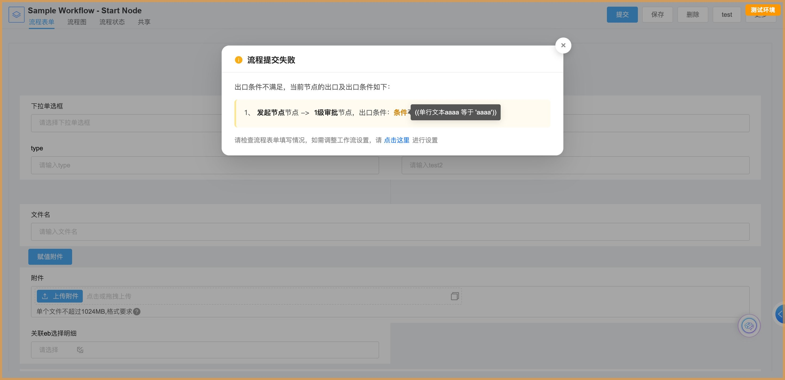

# e10-ecode-workflow-submit-fail-modal

  

**Show a workflow "submit failed" result as a modal dialog instead of an inline red banner — a Weaver e-cology10 e-code second-development app.**



## The problem

When a workflow submit is rejected (for example, no outgoing link condition matched), the E10
workflow detail page renders an inline red banner above the form:

```
div.wffp-operate-msgTip.form-msgtip   →   "流程提交失败" / Submit failed
```

It pushes the form down, and the red error styling reads like a system fault rather than
"please fix your form and submit again".

## What this app does

- Detects the platform's failure tip and presents the very same content as a **centered modal dialog** with a mask.
- **Keeps everything the platform renders** — the title, the link-condition details, the platform's own
  hover tooltip (raw condition expression) and the "click here" navigation to workflow path settings.
- **Softer tone**: white dialog + amber reminder icon + soft amber condition block, instead of a red alert bar.
- Close with the mask, the `×` button or `Esc`. After closing, the inline banner stays hidden and a small
  bottom-right pill (`流程提交失败，查看原因`) re-opens the dialog.

## How it works

Three small pieces, and no forking of platform code:

| File | Preload | Role |
| --- | --- | --- |
| `entry.js` | yes | `regOvComponent('weappWorkflow', 'FPDevBlockSlot', …)`. Hooks only the `Prompts` / `after` slot of the workflow detail page and passes every other slot through untouched (`<Com {...props} ref={ref} />`). Loads the component with `asyncImport`, and falls back to "no change" if the chunk fails to load. |
| `coms/WorkflowSubmitFailModal.js` | no | Tiny state machine (`hidden` / `open` / `closed`): watches for the platform tip node, adds **one class name** to it, and renders the mask + close button. |
| `styles/workflow-submit-fail-modal.css` | yes | Turns the platform tip node into a modal card. Every rule is class-gated, so nothing applies until the component adds the class. |

Because the patch never rewrites the platform's markup, its event handlers keep working
(the condition tooltip, the "click here" link). And if the platform ever renames the tip class,
the app **degrades silently**: nothing happens and the original inline banner is shown as before.

Two details worth knowing if you adapt this approach:

- **The close button is positioned with `calc()`** from the same CSS variables as the card
  (`--wffp-fail-top`, `--wffp-fail-width`), so no extra anchor element is required and the two can't drift apart.
- **Platform hover popovers are `z-index: 999`.** A modal card at `1100` covers them, which makes the
  condition tooltip look broken ("nothing happens when I hover the condition"). The stylesheet lifts
  `.ui-trigger-popupInner` to `1200` while `body.wffp-submit-fail-modal-open` is present.

## Scope

- **PC workflow detail page only** (`/sp/workflow/flowpage/*`).
- Mobile (`MFPMainTabWillMount` / mobile route) and the flow-detail dialog opened from a list
  (URL not under that prefix) are intentionally left untouched — those already live inside their own container.
- Developed and verified against E10 with `@weapp/ecodesdk` 0.1.53 and `@weapp/ui` 0.0.387.

## Project structure

```
e10-ecode-workflow-submit-fail-modal/
├── entry.js                          # regOvComponent hook + async load (preloaded entry)
├── build.json                        # app metadata (ids blank → generated on first build)
├── coms/
│   └── WorkflowSubmitFailModal.js    # modal state machine (91 lines)
├── styles/
│   └── workflow-submit-fail-modal.css# modal card / mask / close / re-open pill (109 lines)
├── config/                           # standard e-code app config files (untouched)
└── screenshot.jpg
```

## Build & deploy

Requires Node.js plus the E10 e-code dev-tools package (`ecodecmd-e10` for compile/build,
and an import path such as `ecode-cli` or the e-code console).

```bash
# compile check
node <e10-devtools>/ecodecmd-e10.mjs compile .

# build → .target/<appId>.zip
node <e10-devtools>/ecodecmd-e10.mjs build .

# import into a project (add the platform's publish option to make it live)
node <e10-devtools>/ecode-cli.mjs package import --file .target/<appId>.zip --project-id <projectId>
```

> `build.json` ships with **blank `id` / `appUUID`**, so the first build generates new ones and importing
> creates a brand-new app. To *update* an app that is already on the platform, download it first (or fill in
> its real ids) so the import matches by `appUUID`.
>
> Note that an imported app is **not live until it is published** — with e-code tooling that is the
> import `--auto-publish` flag (or the publish action in the e-code console).

## Customising

All colours and geometry live in `styles/workflow-submit-fail-modal.css`:

```css
:root {
  --wffp-fail-top: 12vh;              /* distance from the top of the viewport  */
  --wffp-fail-width: min(640px, 92vw);/* dialog width                          */
}
```

To keep the platform's original look instead of the softened palette, drop the
"platform tip node → modal card" section except for the `position / width / z-index` block.

## 中文说明

基于泛微 **e-cology10** 的 **e-code 二次开发**应用：把流程详情页「流程提交失败」的**内联红色横幅改成弹窗**。

- **背景**：流程提交被拒（例如出口条件不满足）时，平台会在表单顶部渲染内联红色提示条
  `div.wffp-operate-msgTip.form-msgtip`，既把表单往下顶，红色的"报错感"也容易被误认为系统故障。
- **做法**：复写 `weappWorkflow.FPDevBlockSlot`，只在「顶部信息提示区」的后置插槽挂载组件；
  组件**不改写平台 DOM**，只给平台已渲染的提示节点加一个类名，由 CSS 把它变成居中弹窗。
  平台原有文案、条件明细、「条件」悬浮提示表达式、「点击这里进行设置」跳转全部保留。
- **交互**：遮罩点击 / `×` / `Esc` 关闭；关闭后内联横幅不再出现，右下角保留
  「流程提交失败，查看原因」入口可重新打开。
- **视觉**：白色对话框 + 琥珀色提醒图标 + 浅琥珀条件块（`#FFFBF0` + 3px `#FFE58F` 左侧细条），
  去掉红色报错观感；卡片、遮罩、关闭按钮、重开入口的层级分别为 `1100 / 1050 / 1150`。
- **兼容性**：平台「条件」的悬浮提示是 `z-index:999` 的浮层，会被弹窗盖住，因此弹窗打开时
  把它抬到 `1200`；若平台后续改了提示节点的类名，本应用会自动"不生效"，页面仍按平台原样展示内联提示。
- **生效范围**：仅 PC 流程详情页 `/sp/workflow/flowpage/*`；移动端与从列表打开的流程弹窗不做改动。
